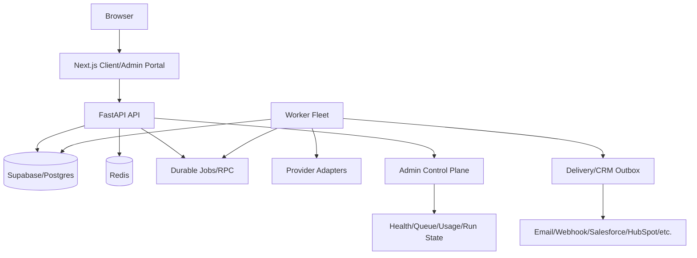

# LeadX Final Product, Runtime, and Scale Plan

## Product direction

LeadX should be positioned as an evidence-first lead operating system for agencies and revenue teams: discover exclusive local opportunities, verify and enrich the right contacts, explain why each lead matters, route leads into CRM and outreach, and keep every operation observable and credit-safe.

The primary buyer is a lead-generation agency. The product combines the strongest useful capabilities from Apollo, ZoomInfo, Clay, Instantly, Salesforce, HubSpot, and adjacent GTM tools without claiming proprietary data coverage that LeadX does not license.

## Competitive strategy

| Competitor category | Strength to match | LeadX differentiation |
|---|---|---|
| Apollo | Unified account/contact data, intent, AI agents, outreach, integrations | Explainable local opportunities, territory exclusivity, agency workspaces, quality guarantees |
| ZoomInfo | Large B2B graph, org charts, routing, intent, CRM sync | Provenance-rich local account/contact graph with field confidence and freshness |
| Clay | Waterfall enrichment and flexible workflows | Automatic free-first waterfall, cost budgets, safe retries, and non-technical UX |
| Instantly | Sequences, warmup, inbox and reply analytics | Quality-gated outreach, deliverability controls, suppression, and CRM-first execution |
| Salesforce | Enterprise CRM, workflow, permissions and reporting | Focused lead-agency CRM with simpler onboarding and better lead-quality context |
| HubSpot | Fast setup and approachable CRM | Similar onboarding simplicity with territory, enrichment, verification and credit economics |

LeadX must win through local-market specialization, evidence-backed “why now” intelligence, target-driven delivery, free-first provider orchestration, transparent provenance, and a reliable client/admin operating model.

## Complete lead flow

```mermaid
flowchart LR
    A[Client/Admin Request] --> B[Auth + Tenant Check]
    B --> C[Fast Target or Quality Campaign Policy]
    C --> D[Durable Job + Idempotency Record]
    D --> E[Budget Reservation]
    E --> F[Discovery Orchestrator]
    F --> G[Free Sources]
    F --> H[Paid Sources]
    G --> I[Deduplicate + Identity Resolve]
    H --> I
    I --> J[Account / Contact Graph]
    J --> K[Enrichment Waterfall]
    K --> L[Verification + Freshness]
    L --> M[Score + Explainability]
    M --> N{Quality Gate}
    N -- Reject --> O[Reason + Metrics]
    N -- Accept --> P[Atomic Assignment]
    P --> Q[CRM Record + Outbox]
    Q --> R[Portal / Email / Webhook / External CRM]
    R --> S[Delivery Outcome]
    S --> T[Credits + Billing Ledger]
    T --> U[Client/Admin Live Updates]
    D --> V[Worker Lease / Retry / Reap]
    V --> U
```

## Runtime architecture

Postgres/Supabase remains the durable source of truth. Redis remains the shared runtime authority for distributed rate limits and approved short-lived cache reads; it is not the durable queue, billing source, authorization boundary, or job state source.

## Core product decisions

### Fast Target Mode

Fast Target Mode is the default for small requests such as “find 5 leads.” Discovery, enrichment, scoring, gating and assignment overlap. The first discovery batch is bounded to the target and a small oversampling factor. Paid calls stop when the target is durably assigned. Provider operations are cancellable where possible, and no duplicate provider operation or credit charge is allowed.

### Quality Campaign Mode

Quality Campaign Mode searches a larger candidate pool, applies deeper enrichment and verification, ranks by fit, intent, contactability, evidence, freshness and exclusivity, and produces a transparent quality report explaining accepted and rejected records.

### Durable operation identity

Every provider-bound operation carries tenant ID, operation kind, job ID, provider-operation ID, idempotency key, request hash, attempt, provider, field, cost/budget reservation and freshness context. Repeated requests replay the existing operation instead of starting duplicate work.

### Canonical data plane

Preserve `leads_global` and `lead_assignments` for compatibility, while adding or finishing account, location, person, contact-method, buying-group, evidence, provenance, freshness, consent and suppression projections. A company may have multiple decision-makers and contact methods.

### Durable delivery

Assignment succeeds independently of an external delivery destination, but every external delivery uses a durable outbox with stable event IDs, retry state, dead-letter state, safe replay, destination mapping, reconciliation and audit history.

## Implementation tasks

### Task 1 — Canonical product and runtime contract

Document the complete state machine for requests, jobs, runs, providers, accounting, client UI and admin UI. Define terminal, retryable, in-progress, degraded and cancelled states. Define Fast Target and Quality Campaign policies. Add state vocabulary checks while preserving all existing job and route names.

**Demo:** an operator can explain exactly how one request reaches success, shortfall, failure, cancellation or replay.

### Task 2 — Remote durable migration preflight

Verify and apply the canonical migrations through the durable job/accounting work, including `job_operations`, `leadx_prepare_job`, `leadx_finish_job_operation`, `leadx_reopen_job_operation`, grants, RLS, indexes and signatures. Reconcile the migration mirror, lineage and runbook. Add startup preflight that reports missing durable objects before provider work starts.

**Demo:** missing migration objects fail clearly and safely instead of accepting work that cannot finish.

### Task 3 — Canonical account/contact/evidence model

Add additive projections for accounts, locations, people, contact methods, titles, buying groups, source evidence, freshness, consent, suppression and field confidence. Keep existing CRM views compatible. Add company/contact deduplication, provenance and cross-tenant tests.

**Demo:** one account shows multiple contacts, roles, evidence, confidence and freshness.

### Task 4 — Provider waterfall and budget orchestrator

Standardize provider adapters by field, capability, cost, confidence, freshness, rate limit and regional policy. Enforce free/local sources first, deduplicate before paid calls, stop completed-field calls, and record provider attempt/cost/outcome data.

**Demo:** the operator can see which providers were used, why, and how many paid calls were avoided.

### Task 5 — True Fast Target Mode

Bound initial discovery batches to target size and oversampling. Start enrichment immediately per candidate, score/gate immediately after enrichment, assign concurrently, cancel producer work when the target is durably assigned, and return truthful partial results when qualified supply is insufficient.

**Demo:** a five-lead request stops at five assigned leads without scanning a large exhaustive pool.

### Task 6 — Universal durable jobs and idempotency

Move every provider-bound path to `jobs.submit`: pipeline, imports, bulk email, CRM bulk actions, agents, missions, schedules, operator prospecting, webhooks, CRM sync, sequences and autonomous campaigns. Retain legacy enqueue only for audited non-provider housekeeping.

**Demo:** repeated submission returns the original/in-progress job and cannot duplicate provider work or billing.

### Task 7 — Verification, quality and replacement economics

Use explicit contact states: unknown, probable, verified, risky, catch-all, invalid, unreachable, suppressed and expired. Store evidence, verification time, freshness, bounce feedback, replacement eligibility and credit reason. Make quality guarantees measurable and auditable.

**Demo:** a client can see why a lead passed and request a replacement with an idempotent credit result.

### Task 8 — Durable delivery and CRM outbox

Add pending, processing, delivered, retryable, dead-letter and cancelled outbox states for email, webhooks, Salesforce, HubSpot, Pipedrive, Close, GoHighLevel and exports. Add stable event IDs, payload hashes, attempts, retry times, safe errors, replay and reconciliation.

**Demo:** a failed CRM sync can be replayed without duplicate assignment or email.

### Task 9 — Unified billing and provider ledger

Unify job reservations, `usage_log`, `lead_credits`, provider usage, Stripe reporting, delivery outcomes, refunds and replacements using immutable ledger events and derived balances. Preserve free-first behavior and exact-once callbacks.

**Demo:** admin can reconcile requested, reserved, consumed, refunded, provider and Stripe quantities.

### Task 10 — Multi-user and concurrency hardening

Separate worker pools by discovery, enrichment, verification, delivery and CRM sync. Add per-tenant and provider concurrency limits, queue backpressure, priority classes, bounded memory/results, starvation prevention, queue age and worker capacity metrics.

**Demo:** multiple tenants can run searches, imports, stage updates and jobs without portal freezes or cross-tenant leakage.

### Task 11 — Client revenue workspace

Refine client routes into a focused workflow: today’s opportunities, lead search/saved views, account/contact detail, pipeline, sequences, replies, imports, integrations, usage/billing and quality center. Enforce loading/success/empty/degraded/unauthorized/deadline states, request IDs, retry actions, accessibility, keyboard focus and responsive behavior.

**Demo:** client signs in, requests leads, watches progress, opens an account, sends outreach, moves a stage and understands quality/usage.

### Task 12 — Admin control plane

Provide tenant/client management, ICP and territory setup, pipeline runs, jobs/workers, provider health/cost, usage/billing, quality/replacements, suppression, CRM sync, security/audit, support and feature flags. Show run state and job state together with queue age, last progress, safe reason codes and auditable controls.

**Demo:** admin creates a client, configures ICP, runs a campaign, sees provider/worker health, retries a failure and reconciles usage.

### Task 13 — Unified live updates

Use realtime as an invalidation hint and bounded polling as fallback. Show run ID, job ID, stage, last progress, queue age, retries and worker status. Stop polling at the runtime deadline with a refresh/retry action.

**Demo:** a run never silently appears stuck.

### Task 14 — Security and compliance

Preserve tenant membership and RLS boundaries. Keep service secrets out of browser bundles/logs. Add suppression/DNC, consent/source metadata, export/delete/access workflows and complete admin audit events. Test tenant tampering, cache isolation, service-key restrictions, CSRF, CORS and redaction.

### Task 15 — Client vertical-slice acceptance

Prove sign-in → five-lead request → durable job → worker claim → discovery → concurrent enrichment → gating → assignment → CRM → outreach → pipeline update → usage/credit update → outage/recovery using synthetic providers and no paid test calls.

### Task 16 — Admin vertical-slice acceptance

Prove admin sign-in → client creation → access provisioning → ICP/territory → five-lead run → queue/worker/provider evidence → assignment/delivery → safe retry → usage/credits → audit/security.

### Task 17 — Compose acceptance

Verify Redis health gating, API readiness, worker capability, portal health, service DNS, worker identity, restart recovery, stale lease recovery, duplicate prevention, migration preflight, safe logs and no secret leakage.

### Task 18 — Observability and performance

Track time to first candidate, time to first qualified lead, time to target assignment, provider calls avoided, cost per qualified lead, verification confidence, bounce/replacement rate, CRM sync success, queue age, worker utilization, tenant latency, retry rate, replies, meetings and revenue attribution.

### Task 19 — Final release gates

Run Python tests, migrations/RLS/schema checks, durable handoff tests, worker/Redis/readiness tests, portal typecheck/build, Playwright contracts, accessibility/performance gates, security/cross-tenant tests, Compose smoke, dummy-environment end-to-end flow and rollback review.

## Delivery order

1. Remote migration/schema preflight
2. Fast Target pipeline and lease stability
3. Universal durable jobs/idempotency
4. Account/contact/evidence graph
5. Provider waterfall and budget ledger
6. Assignment/delivery/CRM outbox
7. Client vertical slice
8. Admin vertical slice
9. Unified live UI
10. Multi-user concurrency
11. Security/compliance
12. Full release gates

## Preservation requirements

- Preserve current route paths, job status names, handler kinds and tenant authorization.
- Preserve free-first discovery/enrichment and suppression before paid spend.
- Preserve atomic quota reservation, exclusivity, quality gates and replacement credits.
- Preserve service-role-only backend tables and functions.
- Preserve external delivery failure as non-destructive to a valid CRM assignment.
- Never use tenant IDs in URLs/cache keys as an authorization boundary.
- Never run provider work before durable job/accounting state exists.
- Never hide infrastructure failure as an empty result or successful request.
- Never include real secrets in source, ZIP artifacts or Git history.

## Current verified runtime status

The local Docker stack has been brought up successfully with the supplied demo environment after adding modern Supabase secret-key support and session/auth compatibility:

- API healthy
- Worker healthy
- Redis healthy
- Portal healthy
- API readiness returns 200
- Portal health returns 200
- Worker queue RPC returns 200
- Worker completes background jobs

The remote Supabase project must still be kept synchronized with the durable job/accounting migrations before new durable pipeline submissions are considered production-ready.
